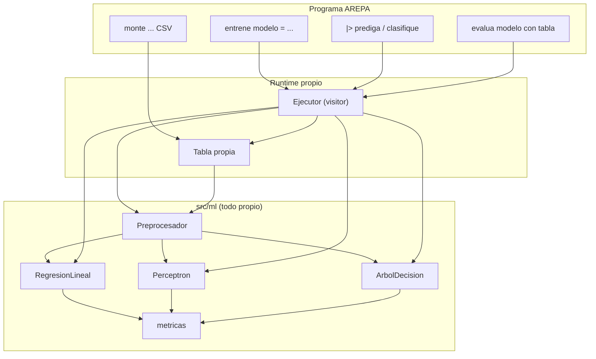
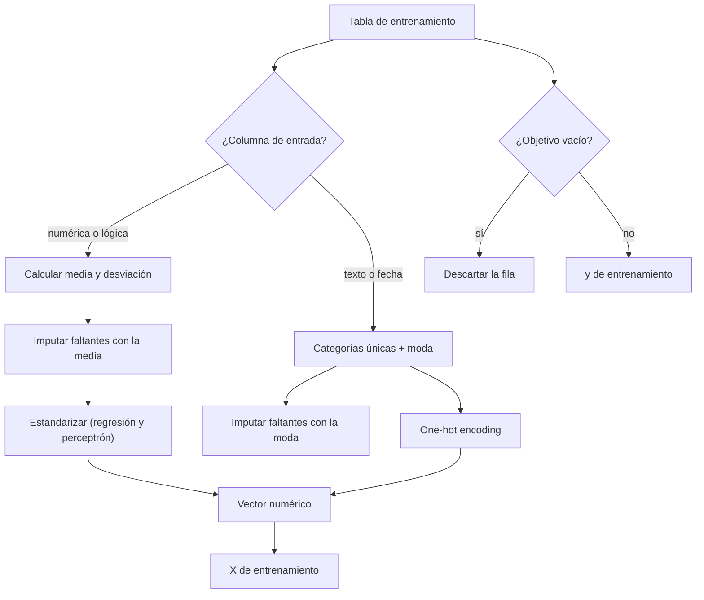
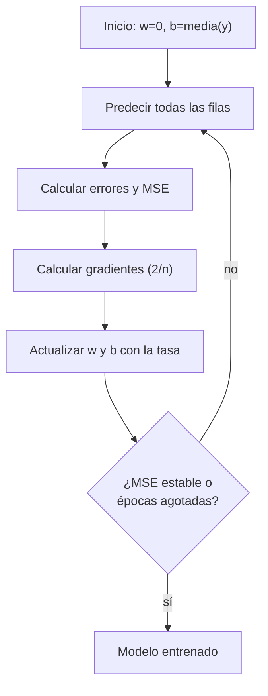
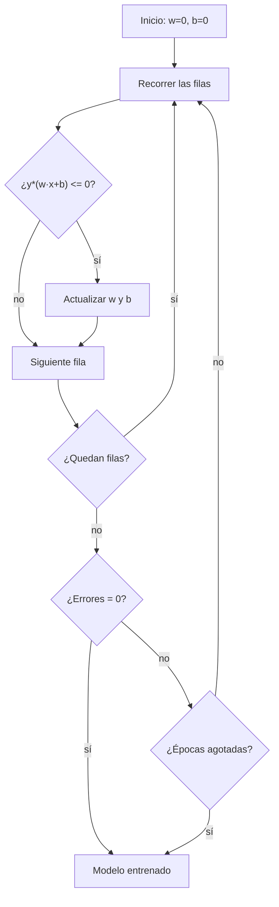
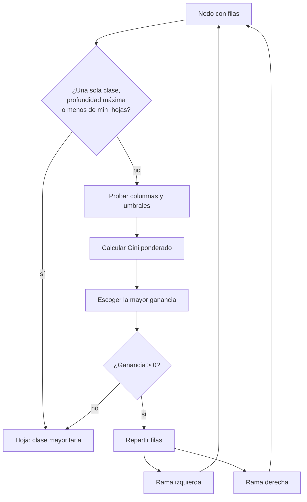
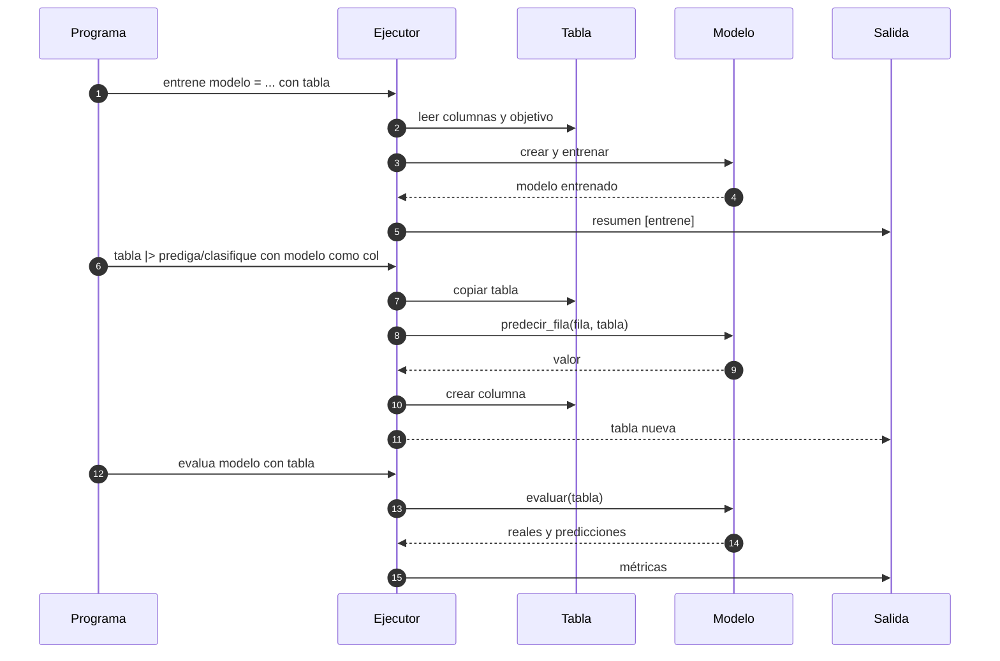

# AREPA — Guía de machine learning (implementación propia)

Esta guía explica la ampliación de machine learning de AREPA: qué se agregó
al lenguaje, cómo se preprocesan los datos, cómo funcionan por dentro la
regresión lineal, el perceptrón y el árbol de decisión, qué métricas se
calculan y cómo se verifica todo. **Ningún algoritmo usa pandas, NumPy,
scikit-learn ni otra biblioteca de machine learning**; la única dependencia
externa del proyecto sigue siendo ANTLR4 para el lexer y el parser.

Todo lo descrito aquí se ejecuta desde la raíz del proyecto con Python 3.

---

## 1. Qué se agregó y dónde vive

| Módulo | Responsabilidad |
|---|---|
| `src/ml/preprocesamiento.py` | imputación, one-hot encoding, estandarización y transformación de tablas nuevas |
| `src/ml/modelo.py` | interfaz común `ModeloML`, jerarquía regresión/clasificación y validación de hiperparámetros |
| `src/ml/regresion_lineal.py` | regresión lineal múltiple con descenso de gradiente por lotes |
| `src/ml/perceptron.py` | perceptrón binario con la regla clásica de actualización |
| `src/ml/arbol_decision.py` | árbol de clasificación CART con impureza de Gini |
| `src/ml/metricas.py` | MAE, MSE, RMSE, R², exactitud, matriz de confusión, precisión, recall y F1 |
| `src/runtime/ejecutor.py` | sentencias `entrene` y `evalua`; etapas `prediga` y `clasifique` |
| `src/runtime/contexto.py` | impresión legible del resumen de un modelo con `cuenteme` |
| `src/datos/tipos.py` | nombre de tipo `modelo` / `regresion` / `clasificacion` para los mensajes de error |



La idea central es que el modelo es **un valor más del lenguaje**: se guarda
en la tabla de símbolos como cualquier variable y se pasa a las etapas del
pipeline por nombre.

---

## 2. Sintaxis

### 2.1 Entrenamiento

```text
entrene MODELO = ALGORITMO con TABLA
  columnas [COL1, COL2, ...]
  objetivo COL
  [clases [ETIQUETA1, ETIQUETA2, ...]]
  [tasa NUMERO]
  [epocas ENTERO]
  [profundidad ENTERO]
  [min_hojas ENTERO]
```

`ALGORITMO` es uno de `regresion`, `perceptron` o `arbol`. Las opciones van en
cualquier orden y pueden repartirse en varias líneas.

| Opción | Obligatoria | Valor | Algoritmos |
|---|---|---|---|
| `columnas [...]` | sí | variables de entrada | todos |
| `objetivo COL` | sí | variable a predecir | todos |
| `clases [...]` | no | etiquetas posibles | `perceptron` (exactamente 2), `arbol` |
| `tasa N` | no | número > 0; por defecto `0.05` | `regresion`, `perceptron` |
| `epocas N` | no | entero > 0; por defecto `1000` | `regresion`, `perceptron` |
| `profundidad N` | no | entero > 0; por defecto `6` | `arbol` |
| `min_hojas N` | no | entero > 0; por defecto `2` | `arbol` |

Validaciones semánticas:

* `columnas` y `objetivo` son obligatorias.
* El objetivo no puede estar también en `columnas` (sería usar la respuesta
  como pista).
* `regresion` no acepta `clases`, `profundidad` ni `min_hojas`.
* `perceptron` no acepta `profundidad` ni `min_hojas`.
* `arbol` no acepta `tasa` ni `epocas`.
* Las etiquetas de `clases` pueden ser cadenas, enteros, decimales o lógicos.

### 2.2 Uso y evaluación

| Sentencia | Efecto |
|---|---|
| `tabla \|> prediga con MODELO como COL` | agrega `COL` con la predicción numérica |
| `tabla \|> clasifique con MODELO como COL` | agrega `COL` con la etiqueta predicha |
| `evalua MODELO con TABLA` | imprime las métricas sobre las filas con objetivo presente |

`prediga` exige un modelo de regresión; `clasifique` exige un modelo de
clasificación (perceptrón o árbol). La columna de salida no puede existir ya
en la tabla.

### 2.3 Programa completo

```text
quihubo
casas = monte "datos/casas_ml.csv" con encabezado

entrene precio_casas = regresion con casas
  columnas [area, habitaciones, antiguedad, ciudad]
  objetivo precio
  tasa 0.08
  epocas 2000

estimadas = casas
|> prediga con precio_casas como precio_estimado

evalua precio_casas con casas
guarde estimadas como "salidas/regresion_casas.csv"
chao
```

Es `ejemplos/regresion.arepa`. Los equivalentes de clasificación están en
`ejemplos/clasificacion.arepa` y `ejemplos/arbol_decision.arepa`.

---

## 3. Preprocesamiento

El `Preprocesador` aprende la codificación **solo con la tabla de
entrenamiento** y luego aplica exactamente la misma codificación a las filas
nuevas. Así el modelo no ve columnas distintas en predicción.



Reglas concretas:

* **Numérica**: todos los valores presentes son números o lógicos. La media y
  la desviación se calculan con bucles propios (desviación poblacional). Si la
  desviación es 0 se usa 1 para evitar división por cero.
* **Categórica**: cualquier otro caso (texto, fecha). Las categorías se
  conservan en orden de primera aparición y se codifican con one-hot.
* **Faltantes**: media en numéricas, moda en categóricas.
* **Categoría desconocida en predicción**: se codifica como un vector one-hot
  de ceros; la predicción no se rompe.
* **Filas con objetivo vacío**: se descartan del entrenamiento y de la
  evaluación. Si todas están vacías, se lanza `ErrorSemantico`.
* **Estandarización**: solo regresión y perceptrón. El árbol trabaja con los
  valores originales (y con los one-hot de las categóricas).
* **Nombres de features**: una columna numérica conserva su nombre; una
  categórica genera nombres como `ciudad=Bogota`, que son los que aparecen en
  los pesos y en el árbol.

Ejemplo: para `ciudad` con valores `Bogota`, `Medellin`, `Cali`,
`Barranquilla`, el vector one-hot tiene cuatro posiciones. El resumen del
modelo muestra la codificación aprendida:

```text
preprocesamiento: area: numérica (media=94.2308, desviación=29.8629);
  habitaciones: numérica (media=3.0385, desviación=1.0554);
  antiguedad: numérica (media=13.32, desviación=7.4389);
  ciudad: categórica (Bogota, Medellin, Cali, Barranquilla)
```

---

## 4. Regresión lineal

### 4.1 Modelo

La regresión lineal múltiple ajusta

```text
y = b + w1*x1 + w2*x2 + ... + wn*xn
```

donde `b` es el sesgo y `w` los pesos. Las entradas llegan estandarizadas
(media 0, desviación 1), lo que estabiliza el descenso de gradiente. La salida
se devuelve en la escala original del objetivo.

### 4.2 Entrenamiento

Se usa **descenso de gradiente por lotes** (batch gradient descent) con la
función de costo cuadrática:

```text
MSE = (1/n) * suma((prediccion_i - y_i)^2)

gradiente_w = (2/n) * suma(error_i * x_i)
gradiente_b = (2/n) * suma(error_i)

w = w - tasa * gradiente_w
b = b - tasa * gradiente_b
```

Detalles de la implementación (`src/ml/regresion_lineal.py`):

* los pesos arrancan en 0 y el sesgo en la media del objetivo;
* en cada época se calculan todas las predicciones, luego todos los
  gradientes y al final se actualizan los parámetros (por lotes, no por fila);
* el historial guarda el MSE de cada época;
* si el MSE cambia menos de `1e-14` entre épocas, el entrenamiento se detiene
  antes de agotar `epocas`;
* `tasa` debe ser un número > 0 y `epocas` un entero > 0.



### 4.3 Ejemplo real

`ejemplos/regresion.arepa` entrena con 25 filas y 4 columnas
(`area`, `habitaciones`, `antiguedad`, `ciudad`) para predecir `precio`:

```text
[entrene] Modelo 'precio_casas' (regresion) entrenado con 25 fila(s), 4 columna(s); objetivo 'precio'.
  pesos: area=82.3148, habitaciones=15.2787, antiguedad=-7.7599,
         ciudad=Bogota=30.3716, ciudad=Medellin=1.9092,
         ciudad=Cali=-12.3778, ciudad=Barranquilla=-24.8954
  sesgo: 323.0077
  MSE final de entrenamiento: 114.8027
  MAE  = 8.506086750859104
  MSE  = 114.80267625998626
  RMSE = 10.714601077967684
  R²   = 0.9902511314317267
```

Interpretación: el R² de 0.99 indica que el modelo explica el 99 % de la
variación del precio en los datos de entrenamiento; el MAE de 8.5 millones de
pesos es el error absoluto promedio (el `precio` de `casas_ml.csv` está en
millones). La columna `precio_estimado` queda en
`salidas/regresion_casas.csv` junto al precio real.

---

## 5. Perceptrón

### 5.1 Modelo

El perceptrón es un clasificador lineal binario. Para una fila `x` calcula

```text
puntaje = w · x + b
```

y devuelve la primera clase si `puntaje >= 0`, o la segunda en caso contrario.
La primera etiqueta de `clases` se aprende como `+1` y la segunda como `-1`.

### 5.2 Entrenamiento

Con la regla clásica del perceptrón:

```text
para cada fila (x, y):
    si y * (w · x + b) <= 0:
        w = w + tasa * y * x
        b = b + tasa * y
```

* si no se da `clases`, se descubren en orden de aparición y se exige que sean
  exactamente 2; con 3 o más se lanza un error que sugiere usar `arbol`;
* los pesos arrancan en 0 y el sesgo en 0;
* el historial guarda el número de errores por época;
* si una época termina con 0 errores, el entrenamiento se detiene;
* las entradas llegan estandarizadas.



### 5.3 Ejemplo real

`ejemplos/clasificacion.arepa` usa 26 filas y 3 columnas
(`horas_estudio`, `asistencia`, `tareas`) para predecir `aprueba`
(`si` = +1, `no` = -1):

```text
[entrene] Modelo 'aprueba_estudiante' (perceptron) entrenado con 26 fila(s), 3 columna(s); objetivo 'aprueba'.
  entrenamiento: regla del perceptrón, tasa=0.1, épocas=300
  clases: si (+1) y no (-1)
  pesos: horas_estudio=0.1433, asistencia=0.0413, tareas=0.1027
  sesgo: 0
  errores en la última época: 0
  exactitud = 1
```

La salida `salidas/clasificacion_estudiantes.csv` contiene la etiqueta real y
la predicha para cada estudiante.

---

## 6. Árbol de decisión

### 6.1 Idea CART

El árbol de clasificación sigue la idea de CART:

1. en cada nodo prueba todas las preguntas `columna <= umbral`;
2. mide la impureza de Gini de cada división;
3. escoge la pregunta que más reduce la impureza (mayor ganancia);
4. repite recursivamente hasta que el nodo es puro o se alcanza un límite.

La impureza de Gini de un conjunto es

```text
Gini = 1 - suma(p_clase^2)
```

y la ganancia de una división es

```text
ganancia = Gini(padre) - (n_izq/n)*Gini(izq) - (n_der/n)*Gini(der)
```

### 6.2 Construcción



Detalles de la implementación (`src/ml/arbol_decision.py`):

* los umbrales candidatos son los puntos medios entre valores ordenados;
* si una columna tiene más de 65 valores distintos, se muestrean como máximo
  64 cortes para acotar el costo;
* las columnas categóricas llegan one-hot, así que el árbol también aprende
  preguntas del tipo "¿la categoría está presente?";
* se detiene si el nodo es puro, si llegó a `profundidad`, si tiene menos de
  `min_hojas` filas, si la ganancia es cero o si una división deja un lado
  vacío;
* la hoja devuelve la clase mayoritaria, respetando el orden de `clases`;
* el resumen imprime el árbol completo con sangría y el conteo por clase.

### 6.3 Ejemplo real

`ejemplos/arbol_decision.arepa` usa 30 filas y 4 columnas (`edad`, `ingreso`,
`deuda`, `historial`) para predecir `riesgo` (`bajo`, `medio`, `alto`):

```text
[entrene] Modelo 'riesgo_cliente' (arbol) entrenado con 30 fila(s), 4 columna(s); objetivo 'riesgo'.
  entrenamiento: CART/Gini, profundidad=5, min_hojas=2
  clases: bajo, medio, alto
  exactitud de entrenamiento: 1
  árbol:
  si ingreso <= 3750:
    si ingreso <= 1650:
      -> alto (n=8, alto=8)
    sino:
      ...
```

El árbol aprendido se puede leer como una serie de preguntas de negocio. La
salida `salidas/arbol_riesgo.csv` guarda el riesgo real y el estimado.

---

## 7. Métricas

### 7.1 Regresión

| Métrica | Fórmula | Qué mide |
|---|---|---|
| MAE | `(1/n) * suma(\|y - p\|)` | error absoluto promedio, en unidades del objetivo |
| MSE | `(1/n) * suma((y - p)^2)` | error cuadrático promedio, penaliza errores grandes |
| RMSE | `raíz(MSE)` | error típico en unidades del objetivo |
| R² | `1 - suma((y-p)^2) / suma((y-media)^2)` | proporción de variación explicada |

Si la varianza del objetivo es 0, R² devuelve 1 cuando el error es 0 y 0 en
otro caso (evita división por cero).

### 7.2 Clasificación

| Métrica | Fórmula | Qué mide |
|---|---|---|
| exactitud | `aciertos / total` | proporción de etiquetas correctas |
| precisión | `VP / (VP + FP)` | de lo que predije como clase, cuánto acerté |
| recall | `VP / (VP + FN)` | de lo que era la clase, cuánto encontré |
| F1 | `2 * precision * recall / (precision + recall)` | media armónica de precisión y recall |
| soporte | filas reales de la clase | tamaño de la clase en la tabla |

La matriz de confusión se imprime con **filas = real** y **columnas =
predicho**, en el orden declarado en `clases` (las clases que aparezcan en
los datos y no estén en esa lista se agregan al final). Las divisiones entre
cero devuelven 0 para no romper el reporte.

### 7.3 Salida de `evalua`

Regresión:

```text
[evalua] Modelo 'precio_casas' sobre 'casas':
Métricas de regresión (25 filas):
  MAE  = 8.506086750859104
  MSE  = 114.80267625998626
  RMSE = 10.714601077967684
  R²   = 0.9902511314317267
```

Clasificación:

```text
[evalua] Modelo 'riesgo_cliente' sobre 'clientes':
Métricas de clasificación (30 filas):
  exactitud = 1

  Matriz de confusión (filas = real, columnas = predicho):
            bajo   medio    alto
  bajo          9       0       0
  medio         0      12       0
  alto          0       0       9

  Por clase:
    bajo: precisión=1, recall=1, F1=1, soporte=9
    medio: precisión=1, recall=1, F1=1, soporte=12
    alto: precisión=1, recall=1, F1=1, soporte=9
```

---

## 8. Integración con el pipeline

`prediga` y `clasifique` son etapas de datos: reciben una tabla y devuelven
una copia con una columna nueva. No modifican la tabla original (decisión D3).
La predicción se calcula fila por fila con la codificación aprendida.



Errores semánticos cubiertos:

* modelo inexistente → `ErrorVariable` con la pista de entrenarlo primero;
* variable que no es modelo → `ErrorTipos` con el tipo real;
* `prediga` con perceptrón o árbol → `ErrorSemantico`;
* `clasifique` con regresión → `ErrorSemantico`;
* columna de salida ya existente → `ErrorColumna`;
* columna de entrada u objetivo inexistente → `ErrorColumna` con las columnas
  disponibles;
* opciones incompatibles con el algoritmo → `ErrorSemantico`;
* objetivo no numérico en regresión → `ErrorSemantico`.

---

## 9. Ejemplos y evidencia

### 9.1 Conjuntos de datos

| Archivo | Filas | Columnas | Uso |
|---|---|---|---|
| `datos/casas_ml.csv` | 26 | `area, habitaciones, antiguedad, ciudad, precio` | regresión; una antigüedad vacía y un precio vacío |
| `datos/estudiantes_ml.csv` | 27 | `horas_estudio, asistencia, tareas, aprueba` | perceptrón binario; tareas y etiqueta vacías |
| `datos/riesgo_ml.csv` | 30 | `edad, ingreso, deuda, historial, riesgo` | árbol multiclase con columna categórica |

### 9.2 Programas

| Programa | Algoritmo | Salida |
|---|---|---|
| `ejemplos/regresion.arepa` | regresión lineal | `salidas/regresion_casas.csv` |
| `ejemplos/clasificacion.arepa` | perceptrón | `salidas/clasificacion_estudiantes.csv` |
| `ejemplos/arbol_decision.arepa` | árbol CART/Gini | `salidas/arbol_riesgo.csv` |

### 9.3 Cómo correrlos

```bash
python3 src/cli/main.py ejemplos/regresion.arepa --ejecutar
python3 src/cli/main.py ejemplos/clasificacion.arepa --ejecutar
python3 src/cli/main.py ejemplos/arbol_decision.arepa --ejecutar
```

Cada corrida imprime el resumen del modelo, las métricas y la tabla de
muestra, y deja el CSV de evidencia en `salidas/`. Los tres CSV están
versionados (exceptuados en `.gitignore`).

---

## 10. Pruebas

La suite propia es `pruebas/test_ml.py`: **31 pruebas** que no usan
bibliotecas externas para lo que verifican.

| Grupo | Pruebas | Qué cubre |
|---|---|---|
| Preprocesamiento | 5 | imputación media/moda, one-hot, descarte de objetivo vacío, objetivo repetido, columna inexistente |
| Métricas | 4 | MAE/MSE/RMSE/R², matriz de confusión, precisión/recall/F1, listas vacías |
| Modelos | 10 | regresión lineal, tasa inválida y objetivo no numérico, perceptrón binario y orden de clases, árbol multiclase, profundidad, `min_hojas`, tipo reportado y resumen |
| Integración DSL | 12 | `prediga` + `guarde`, `clasifique` con perceptrón y árbol, `evalua`, errores de tipo/opciones/columnas/objetivo/modelo |

```bash
python3 pruebas/test_ml.py          # solo la suite de ML
python3 pruebas/test_proyecto.py    # 9 suites, 350 pruebas
python3 herramientas/chequeo_pruebas.py  # verifica el conteo canónico
```

El conteo canónico es `55 + 28 + 43 + 48 + 16 + 15 + 51 + 63 + 31 = 350`.

---

## 11. Decisiones, limitaciones y extensiones

### Decisiones

* **D12 — ML como instrucciones propias**: `entrene`, `prediga`, `clasifique`
  y `evalua` mantienen el estilo declarativo y separan entrenamiento, uso y
  medición.
* **D13 — `min_hojas` en vez de `minimo`**: `minimo()` ya existe como
  agregación; `min_hojas` evita ambigüedad léxica y describe el parámetro.
* **Primera clase = +1** en el perceptrón: hace determinista la codificación
  binaria y queda documentado en el resumen del modelo.
* **Estandarización solo en regresión y perceptrón**: el árbol no la necesita
  porque sus divisiones son por umbrales y así conserva la legibilidad.
* **Una sola implementación de preprocesamiento**: entrenamiento y predicción
  usan exactamente la misma codificación, evitando el sesgo de transformar
  distinto en cada fase.

### Limitaciones

* El perceptrón es binario; para 3 o más clases se usa `arbol`.
* No hay validación cruzada ni división automática entrenamiento/prueba: las
  métricas de `evalua` se calculan sobre la tabla que se le pasa (si es la de
  entrenamiento, son métricas de entrenamiento).
* El árbol es de clasificación; no hay árbol de regresión.
* No hay poda posterior del árbol; los límites son `profundidad` y
  `min_hojas`.
* No hay guardado/carga de modelos en disco: el modelo vive mientras corre el
  programa.
* La regresión usa descenso de gradiente, no la solución cerrada; con tasas
  malas puede converger lento.

### Cómo agregar otro algoritmo

1. Crear una clase en `src/ml/` que herede de `ModeloRegresion` o
   `ModeloClasificacion`.
2. Implementar `entrenar(X, y)`, `predecir(vector)` y `resumen()`.
3. Reutilizar el `Preprocesador` y las métricas existentes.
4. Agregar el token al `.g4`, regenerar ANTLR y extender `algoritmo_ml` y
   `visitInstruccion_entrene`.
5. Agregar pruebas a `pruebas/test_ml.py` y actualizar el conteo canónico.

---

## 12. Referencias

* *Grokking Machine Learning* (2021): regresión lineal, descenso de
  gradiente, perceptrón, árboles de decisión y métricas.
* *Grokking Artificial Intelligence Algorithms*: intuición de los algoritmos
  de clasificación y de los árboles.
* Documentación del proyecto: `docs/02_catalogo_instrucciones.md` (D12/D13),
  `docs/03_gramatica_ebnf.md` (§6), `docs/05_arquitectura.md` (§6 y §10),
  `docs/09_reglas_semanticas.md` (§9).
